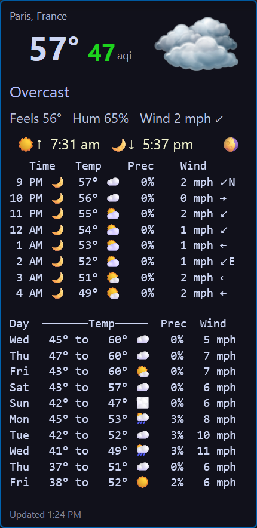
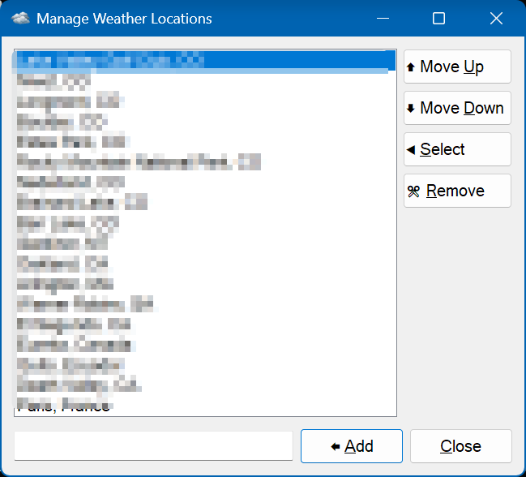

# Weather Widget

A compact, always-available desktop weather widget for Windows, written in AutoHotkey v2.1 (Requires 2.1 Alpha 23 or later). It shows current conditions, air quality, an hourly outlook, and a multi-day forecast in a small borderless window, and mirrors the current conditions in the system tray icon.



No API keys or accounts are needed. Weather and air quality come from [Open-Meteo](https://open-meteo.com/), and place names are resolved with OpenStreetMap [Nominatim](https://nominatim.openstreetmap.org/).

---

## Features

### Current conditions

- Location name, large current temperature, and a weather icon
- **US AQI** (air quality index), color-coded by level: green, yellow, orange, red, purple, maroon
- Condition text (e.g. "Partly cloudy", "Light rain") based on WMO weather codes
- Feels-like temperature, relative humidity, wind speed, and wind direction arrow
- Cold (❄) or hot (🌡️) marker when the temperature is below 40°F / 4°C or above 90°F / 32°C
- Sunrise and sunset times plus the current moon phase

### Daily forecast

- Weekday, low and high temperature, weather emoji, max precipitation chance, and max wind
- 1 to 16 days, configurable
  
### Hourly forecast

- Time, day/night marker, temperature, weather emoji, chance of precipitation, wind speed and direction
- Starts at the next hour, with configurable row count and hour spacing
- Moon-phase symbol shown in place of the sun on clear nights
- Hourly increment and total rows show are user configurable

### Window and display

- Borderless, rounded-corner window with a drop shadow (rounded corners on Windows 11; ignored on Windows 10)
- Dark theme that automatically shifts to a deeper background at night
- Color emoji rendered through Direct2D/DirectWrite for crisp output (can be disabled)
- Adjustable display scale from 0.75x to 2.0x
- DPI aware
- Stays on all virtual desktops
- Snaps back fully onto a monitor's work area if it ends up off-screen, e.g. after a monitor change
- Window position is remembered between sessions

### Tray icon

- Tray icon changes with current conditions, with optional night-time variants
- Tooltip shows location, temperature, and condition
- Click the tray icon to show the widget; Ctrl+click to hide it

### Reliability

- Automatic refresh on a configurable interval (default 30 minutes)
- If a refresh fails, the widget shows the error on the status line and retries after one minute
- Refreshes shortly after unlocking the workstation (about 5 s) or resuming from sleep (about 10 s)
- Refresh timer is paused while the session is locked
- Redraws the window after a display configuration change
- Releases working-set memory after each refresh to keep the footprint small
- Multiple instances are allowed (`#SingleInstance Off`)

---

## Using the widget

| Action | Result |
|---|---|
| **Left-click and drag** anywhere on the widget | Move the window (it snaps back onto a monitor on release) |
| **Right-click** | Open the settings and location menu |
| **Left-click tray icon** | Show the widget |
| **Ctrl + left-click tray icon** | Hide the widget |

### Right-click menu

| Item | Description |
|---|---|
| **Manage Locations** | Opens the Location Manager (see below) |
| *Location list* | Your saved locations, in the order they appear in the INI file. Click one to switch. The current location is checked. |
| **Display Forecast Days** | 1 to 16 days of daily forecast |
| **Display Max Hourly Rows** | 1 to 15 rows of hourly forecast |
| **Display Hourly Interval** | Hours between hourly rows, 1 to 6 |
| **Refresh Minute Interval** | 5 to 60 minutes, in steps of 5 |
| **Display Scale Factor** | 0.75, 0.8, 0.9, 0.95, 1, 1.05, 1.1, 1.2, 1.25, 1.5, 1.75, 2.0 (rebuilds the window) |
| **Edit Settings File** | Opens `WeatherWidget.ini` in your default editor |
| **Always On Top** | Toggle keeping the widget above other windows |
| **Metric Units** | Toggle °C / km/h versus °F / mph |
| **Exit** | Close the widget (saves position first) |

If the INI file does not exist yet, the menu offers **Refresh now** in place of the location list.

### Location Manager



A resizable dialog for maintaining your saved locations:

| Control | Action |
|---|---|
| **Move Up / Move Down** | Reorder the selected location (this is the order shown in the right-click menu) |
| **Select** | Switch the widget to the selected location |
| **Remove** | Delete the selected location from the list |
| **Edit box + Add** | Type a place name (e.g. `Denver, CO` or `Paris, France`). It is verified through a geocoding lookup before being added; unknown places are rejected. |
| **Close** | Close the dialog (Esc also works) |

Duplicate names are rejected. Coordinates are cached in the INI file, so switching to a known location does not need another geocoding lookup.

---

## Settings file (`WeatherWidget.ini`)

The INI file is created next to the script. Most settings live in a section named after the computer (`A_ComputerName`), so different machines sharing a folder can keep their own settings.

```ini
[MYPC]
Loc=Los Angeles, California, United States
Refresh Minutes=30
Forecast Days=2
Hours Increment=3
Max Rows=8
FontScaling=1
OnTop=0
MKS=0
UseD2D=1
X=1500
Y=100

[Locations]
Los Angeles, California, United States
Denver, CO

[Denver, CO]
CC=us
Lat=39.7392
Lon=-104.9847
FullName=Denver, Colorado, United States
```

| Key | Section | Meaning | Default |
|---|---|---|---|
| `Loc` | computer name | Currently selected location | Estimated at first run |
| `Refresh Minutes` | computer name | Minutes between refreshes | 30 |
| `Forecast Days` | computer name | Days in the daily forecast | 2 |
| `Hours Increment` | computer name | Hours between hourly rows | 3 |
| `Max Rows` | computer name | Number of hourly rows | 8 |
| `FontScaling` | computer name | Display scale factor | 1 |
| `OnTop` | computer name | 1 = always on top | 0 |
| `MKS` | computer name | 1 = metric units | 0 |
| `UseD2D` | computer name | 1 = Direct2D color emoji; 0 = plain text controls. Change by hand, then restart. | 1 |
| `X`, `Y` | computer name | Saved window position | 0, 0 |
| *(each line)* | `[Locations]` | Saved location names. A `key=value` form is accepted; only the value is used. | |
| `Max Locations` | `[Default]` | Maximum locations listed in the right-click menu | 50 |
| `CC`, `Lat`, `Lon`, `FullName` | `[<place name>]` | Cached geocoding result for that place | |

Changes made through the menu are written immediately. Edits made by hand to the refresh interval, forecast days, hourly interval, and max rows are picked up the next time you switch locations; for other settings, restart the widget.

---

## Requirements

- Windows 10 or 11
- [AutoHotkey v2.1](https://www.autohotkey.com/) or later (`#Requires AutoHotkey v2.1-`)
- `DirectWriteClass.ahk2` in the same folder (provides the `D2DText` class used for color emoji)
- Internet access for weather, air quality, and location lookups

### Icon files (optional but recommended)

Place `.ico` files in the script folder. The tray icon and the picture in the widget corner are chosen by condition name:

`Clear`, `Light Clouds`, `Partly Cloudy`, `Overcast`, `Fog`, `Drizzle`, `Freezing drizzle`, `Light Showers`, `Rain`, `Freezing rain`, `Light Snow`, `Snow`, `Heavy Snow`, `Thunderstorm`

At night, the widget first looks for the same name prefixed with `Night ` (e.g. `Night Clear.ico`) and falls back to the daytime icon. Missing icons are skipped without error.

---

## Running and building

1. Place `WeatherWidget.ahk2`, `DirectWriteClass.ahk2`, and the icon files in one folder.
2. Can run `Weather.exe` directly or `WeatherWidget.ahk2`with AutoHotkey v2.1+
3. On the first run, if no location is configured, you are prompted for one. An estimate based on your IP address is pre-filled; edit it as needed. That will be the last time your are promted for a location.

To produce a standalone `Weather.exe`, compile with Ahk2Exe. The script's `;@Ahk2Exe-` directives already set the name, version, copyright, and main icon (`Partly Cloudy.ico`).

---

## Data sources

| Purpose | Service |
|---|---|
| Weather forecast | `api.open-meteo.com` |
| US AQI | `air-quality-api.open-meteo.com` |
| Place name to coordinates | `nominatim.openstreetmap.org` |
| Default location estimate (first run only) | `ipwho.is` |
